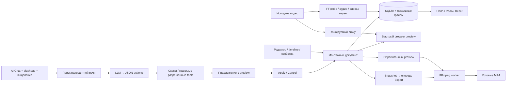

# Архитектура ClipForge AI Video Editor

## Стек и границы

Приложение использует существующие React + TypeScript + Vite, FastAPI, SQLite, отдельный Python-воркер и локальный диск. FFmpeg выполняет media-операции, faster-whisper — транскрипцию, Ollama/OpenAI — смысловой отбор и разбор команд. Сборка рассчитана на одного пользователя и один узел. Нет аккаунтов, разделения арендаторов и распределённой очереди; сервер по умолчанию слушает только loopback.

Рефакторинг расширяет текущий проект: старые проекты, исходники, таблицы и готовые MP4 сохраняются. Интерфейс редактора заменён; старый UI не работает параллельно с новым. Совместимые старые API остаются для существующих клиентов и экспортов.



## Неразрушающий монтаж

Исходник не переписывается после каждого действия. Редактор хранит документ версии 1:

```json
{
  "version": 1,
  "segments": [
    {"id": "intro", "start": 12.5, "end": 25.1, "speed": 1, "effects": {}},
    {"id": "reaction", "start": 27.8, "end": 58.2, "speed": 1.2,
     "effects": {"zoom": 1.15}}
  ],
  "settings": {"layout": "crop", "aspect_ratio": "9:16", "subtitles": true},
  "transition": {"type": "none", "duration": 0.2},
  "caption_overrides": {}
}
```

Пример сокращён: backend дополняет и проверяет полный набор настроек. `segments.start/end` — абсолютные секунды **исходника**, порядок массива задаёт порядок воспроизведения. Команды `trim`, `cut`, `split`, `zoom` и выделение используют секунды **готового timeline**. Операции с явными source-диапазонами применяются к исходнику. При изменении скорости и порядка renderer пересчитывает положение слов; fade-переходы уменьшают суммарную длительность на перекрытие.

Эффект на часть клипа разбивает сегменты на границах выделения. Zoom, текст и громкость остаются прикреплены к своим фрагментам при перемещении. Удаление пауз разрешается в реальные cuts до preview; timeline показывает вырезанные интервалы, а не скрытый флаг экспорта.

Ограничения схемы: до 256 сегментов, 32 actions в одном запросе, скорость 0.25–4×, непустой результат до 24 часов. Для fade длительность перехода не может превышать половину самого короткого выходного сегмента. Неизвестные поля, команды, бесконечные числа и выход за границы исходника отклоняются.

## Autosave, ревизии и история

`editor_store.py` создаёт документ старого клипа при первом открытии. Сохранение использует ожидаемую `revision` и транзакцию SQLite: устаревший запрос получает HTTP 409, а не перезаписывает изменения другой вкладки. Frontend сериализует изменения и выполняет отложенное autosave. Playhead не сохраняется каждый кадр и передаётся отдельно как контекст команды.

Undo/Redo перемещают курсор между снимками, Reset создаёт изменение от исходного состояния. Начальное состояние хранится отдельно; история ограничена 100 снимками. Новая правка после Undo создаёт новую ветвь и удаляет недоступную Redo-ветвь. Чат, предложения и их статусы сохраняются в SQLite независимо от открытого браузера.

Старый экспорт не исчезает во время редактирования: новый Export фиксирует отдельный snapshot документа. Его завершение не меняет монтаж, который пользователь успел отредактировать после отправки задания.

## AI Chat и инструменты

Чат использует `ANALYSIS_PROVIDER`: Ollama или OpenAI. Эвристический режим автоматического отбора не выдаётся за LLM-чат. Быстрые ручные actions могут выполняться без LLM, но семантический запрос требует доступной модели.

Pipeline команды:

1. Прочитать текущую ревизию, playhead, выделение и ограниченную историю чата.
2. Найти подходящие слова/фразы в транскрипции. Используется локальный поиск и отбор окон, без обязательного embedding-сервера.
3. Передать LLM небольшой релевантный контекст: до 480 слов и ограниченный текстовый payload. Многочасовая транскрипция не отправляется целиком.
4. Получить JSON `{summary, actions}` по схеме реестра tools.
5. Проверить JSON, типы, разрешённые команды, диапазоны, актуальность revision и итоговый документ.
6. Сохранить предложение, показать его на timeline/preview. Только **Apply changes** сохраняет предложенный монтаж; Cancel его отклоняет.

Tools: trim, cut/remove, split, move, speed, zoom, crop, resize, reframe, layout, face-aware framing, subtitles, subtitle style, text overlay, normalization, volume, fade transition, silence removal, hook, source-range replacement, transcript search, automatic highlights и TikTok preset. Реестр отделён от чата: добавление tool требует схемы и обработчика, а не исполнения свободного текста.

LLM не имеет инструмента shell/exec и не передаёт команды напрямую FFmpeg. Текст транскрипта и прежнего чата считается недоверенным материалом. Если данных для «здесь», крика или игровой реакции недостаточно, модель должна запросить уточнение, а не заявлять, что увидела событие.

Кэш учитывает запрос, документ/revision, положение/выделение, найденные доказательства, выбранную модель и схему tools. Результат для старой ревизии не применяется к новому монтажу. Отмена команды помечает запрос отменённым и запрещает публикацию позднего предложения. Уже отправленная работа внешнего провайдера может завершиться и оплачиваться по его правилам.

## Preview и финальный рендер

Есть три различных режима:

- **Browser preview:** source/proxy и монтажные инструкции. Перемотка, склейки и основные эффекты видны быстро, без FFmpeg после каждого движения. Это монтажное приближение: browser-композиция не обязана пиксельно совпадать с ASS, face-crop и сложными переходами FFmpeg.
- **Обработанный preview:** явный запрос в очередь, низкое разрешение и быстрый encode. Позволяет проверить фактические эффекты до финального экспорта. Результат кэшируется по исходнику, EDL и параметрам.
- **Export:** отдельный snapshot и фоновое задание; итоговый MP4 создаётся по нажатию Export. Закрытие браузера не прерывает worker.

Proxy хранит более лёгкую копию источника, не заменяя оригинал. Качество preview: Auto, 360p, 480p, 720p и 1080p. Пока proxy готовится, исходник остаётся доступен. Переиспользование требует существующего файла и подходящего ключа, одного статуса `done` недостаточно.

Media engine выбирает исходные диапазоны с seek, применяет скорость/atempo и эффекты, соединяет фрагменты или делает crossfade, пересчитывает абсолютные слова в output-время и вшивает субтитры. Готовый файл публикуется атомарно после проверки FFprobe. Исходное видео остаётся неизменным.

## Export и качество

Платформы: TikTok, YouTube Shorts, Instagram Reels и Custom. Разрешения: 720p, 1080p, 1440p, 4K; для 4K требуется источник не ниже 3840×2160 по двум измерениям. Соотношение сторон задаётся монтажом; стандартный вертикальный режим — 9:16. Число `1080p` обозначает короткую сторону: для 9:16 это 1080×1920.

FPS: Original, 30 или 60. Кодеки: H.264 и H.265. Простые профили Fast / Balanced / High Quality / Maximum подбирают скорость кодирования и качество; Advanced разрешает ручной CRF и максимальный bitrate. Оценка размера вычисляется по длительности и ориентиру bitrate, поэтому фактический CRF-экспорт может заметно отличаться.

Стадии задания: Preparing, Rendering, Adding subtitles, Encoding, Finalizing, Done. Фактический порядок внутренних этапов зависит от filter graph: субтитры могут быть включены в тот же encode, а не в отдельный полный проход. API показывает реальные выполняемые этапы, не имитирует независимые рендеры.

## Очередь, отмена и хранение

SQLite сохраняет задания анализа, подготовки, proxy, preview и export. Один OS-locked worker исполняет тяжёлые операции. Proxy/preview/export получают progress, cancel flag, retry и отдельные ссылки. Во время FFmpeg отмена проверяется периодически и завершает дочерний процесс; для STT/LLM отмена кооперативная и не гарантирует мгновенной остановки уже выполняемого внешнего запроса.

Активный проект нельзя удалить одновременно с обработкой. Сначала запросите отмену и дождитесь освобождения задания. Восстановление после перезапуска возвращает незавершённые задания в очередь, а отменённые не должны возобновляться. Повторный анализ сохраняет существующие ручные правки и экспорты; переиспользуются подходящие транскрипты и результаты отбора.

`DATA_DIR` содержит базу, источники, транскрипты, сигналы, waveform, proxy, manifests и результаты. Относительный путь считается от корня проекта. Manifest хранит snapshot монтажа/слов отдельно от публичного job JSON. Старые исходники очищаются по `RETENTION_DAYS`; готовые экспорты остаются, но после удаления исходника новый render невозможен.

Ограничение загрузки применяется к входящему HTTP-body до полного multipart-spooling и повторно к самому файлу. Оригиналы и generated-файлы остаются вне Git. Ограничение одного файла не заменяет общую квоту диска: она остаётся задачей эксплуатации.

## Карта модулей

| Модуль | Ответственность |
| --- | --- |
| `main.py` | Существующие проекты, загрузка, настройки, совместимые клипы и SPA |
| `upload_limit.py` | Ограничение входящего body до multipart parsing |
| `editing.py` | Чистая схема EDL и разрешённые actions |
| `editor_store.py` | Additive schema, CAS, snapshots, Undo/Redo/Reset |
| `editor_ai.py` | Retrieval, bounded LLM intent, chat/proposals/cache |
| `editor_api.py` | Editor HTTP, transcript pages, preview/export endpoints |
| `editor_jobs.py` | Durable jobs, manifests, cancellation and render cache |
| `editor_media.py` | EDL renderer, proxy, waveform, progress/cancel |
| `worker.py` | Выполнение очереди, подготовка источников, очистка |
| `ai.py` | STT и контекстный отбор автоматических клипов |
| `media.py` | Общие FFmpeg/FFprobe и совместимый старый render |
| `signals.py` | Недорогие RMS/паузы/активность аудио |

Frontend разделён на pages, editor components, typed API и hooks. Timeline использует ограниченные данные waveform; транскрипция загружается страницами и по окну воспроизведения. Старый монолитный редактор и его каскад CSS заменяются активными модулями, без файлов `EditorNew`/`Final2`.

## Локально и платно

FFmpeg, SQLite, faster-whisper и Ollama работают локально без оплаты API. Для первого запуска нужны загрузки моделей. Платные варианты используют OpenAI transcription и/или text API; ключ задаётся только сервером. PyAV закреплена на 18.0.0: версия 19 удалила аргумент, который использует установленный faster-whisper.

Иллюстративный бюджет обработки часа речи — $0,4–1,5 AI-затрат, а не проверенный актуальный тариф. Считайте `60 × цена STT/мин + input/output tokens × тариф модели`; отдельно идут CPU/GPU, диск и трафик. Каждая новая команда чата добавляет запрос, если он не переиспользован из кэша. Локальная цена API равна $0, но оборудование и время обработки остаются расходами.

## Текущие ограничения

- Один пользователь, одна машина и один тяжёлый worker; это не публичный многопользовательский SaaS.
- Поиск лица — редкие локальные выборки и стабильное кадрирование, без гарантированного покадрового tracking.
- Не реализовано полное визуальное понимание эмоций, событий игры и чата на экране; AI работает с доступной речью и явно предоставленными сигналами.
- Browser preview — приближение; обработанный preview и MP4 служат окончательной проверкой.
- 256 сегментов, 100 snapshots и bounded context — сознательные ограничения текущего редактора.
- Качество автоматического отбора и команд LLM зависит от модели. Viral Score не прогнозирует просмотры.
- Реальный AI inference, Windows-исполнение и многочасовая нагрузка подтверждаются только отдельными фактическими проверками. Актуальные результаты фиксируются в [VALIDATION.md](VALIDATION.md), а не предполагаются наличием адаптера.
