# Архитектура ClipForge

## Что решает MVP

Один пользователь загружает запись и получает небольшое число вертикальных клипов. Длительные операции выполняются отдельно от HTTP-запросов. Перезагрузка страницы не прерывает транскрипцию и рендеринг; SQLite хранит состояние проектов, клипов и заданий.

Стек: React + TypeScript + Vite, FastAPI, SQLite, отдельный Python-воркер, FFmpeg/FFprobe, faster-whisper, HTTP-адаптеры Ollama/OpenAI. Для текущего сценария этот набор проще в установке на Windows, чем несколько контейнеров и внешняя очередь. SQLite и локальная файловая система — осознанное ограничение одного узла, а не архитектура горизонтального масштабирования.

```mermaid
flowchart LR
    UI[React: dashboard / upload / editor] --> API[FastAPI]
    API --> DB[(SQLite: проекты, клипы, очередь)]
    API --> Files[(Исходники и MP4)]
    DB --> Worker[Отдельный воркер]
    Worker --> Probe[FFprobe + извлечение аудио]
    Probe --> STT[Whisper: слова с таймкодами]
    STT --> Signals[Транскрипт + дешёвые аудиосигналы]
    Signals --> Analyze[Контекстные фрагменты → кандидаты]
    Analyze --> Rank[Уточнение границ и ранжирование]
    Rank --> Render[FFmpeg: 9:16 + субтитры + звук]
    Render --> Files
    Worker --> DB
```



## Структура

```text
frontend/                 React, TypeScript, стили и Vite
backend/
  app/
    main.py               HTTP API и раздача frontend/dist
    worker.py             исполнение устойчивой очереди
    ai.py                 транскрипция и анализ кандидатов
    signals.py            недорогой анализ аудио
    media.py              FFprobe, FFmpeg, субтитры и рендер
  tests/                  проверки API, очереди и обработки
  requirements.txt
docs/ARCHITECTURE.md
scripts/start.ps1         Windows launcher
scripts/start.sh          Bash launcher
.env.example
data/                     генерируемые данные, не исходный код
.logs/                    логи launcher, не исходный код
```

Дополнительные служебные модули backend отделяют настройки и хранение от API. Конкретный каталог данных задаётся `DATA_DIR`; секреты не должны попадать в БД результатов или клиентскую сборку.

## Pipeline

1. **Uploading.** API принимает файл потоком с ограничением размера. Импорт URL разрешён только для публичных записей YouTube/Twitch; скачивание происходит в воркере. Пользователь должен иметь право обрабатывать контент. Прямой эфир не используется как бесконечный источник.
2. **Extracting audio.** FFprobe проверяет контейнер, аудио/видео и длительность. FFmpeg создаёт моно WAV 16 кГц для распознавания. Исходник сохраняется отдельно от производных файлов.
3. **Transcribing.** Локальный faster-whisper использует CPU/int8; облачный адаптер разбивает аудио на части для ограничения размера запроса. Слова получают абсолютные таймкоды исходного видео.
4. **Analyzing.** Вместо отправки многочасового текста в один запрос транскрипт разбивается на перекрывающиеся фрагменты. Локальная статистика аудио помогает описать активность и паузы, но не подменяет понимание речи.
5. **Finding clips.** Анализатор предлагает небольшое число кандидатов с объяснениями. Границы проверяются по реальным словам и длительности исходника, повторяющиеся интервалы исключаются. Затем лучшие кандидаты уточняются и ранжируются.
6. **Rendering.** Для каждого кандидата создаётся 1080×1920 MP4: crop/fit/split, субтитры с подсветкой слова и нормализация громкости. Редактор ставит повторный экспорт в ту же очередь.
7. **Done.** Состояние и готовые файлы доступны независимо от открытого браузера. MP4 можно получить отдельно или в ZIP.

При ошибке сохраняется состояние с объяснением. Система не помечает проект успешным без готового экспорта и не заменяет недоступную LLM случайными оценками. Режим `heuristic` выбирается явно и обозначает ограниченный отбор без семантического понимания.

## Как выбираются моменты

Приоритет — самостоятельный сюжет, а не максимум громкости. Задача LLM: найти хук, развитие события, неожиданность/реакцию и завершение. Пример: если кульминация около 01:35:20, кандидат должен включать предысторию, обычно 10–30 секунд, и закончиться после результата реакции. Перекрывающиеся окна уменьшают риск потерять контекст на границах фрагментов.

LLM возвращает структурированные кандидаты с временными интервалами и причинами. Сервер проверяет типы, конечность чисел, попадание в исходник, допустимую длину и соответствие словам. Целевая длина — 30–90 секунд; для исходника короче 30 секунд возможен короткий клип. Полное понимание завершённости истории вероятностное: финальная проверка пользователем остаётся полезной.

Рубрика оценки учитывает:

- силу начала и понятность без остального стрима;
- развитие и логическое завершение;
- неожиданность, эмоцию и потенциальную реакцию зрителя;
- плотность содержания и отсутствие длинных пустых отрезков.

Кандидаты проходят удаление пересечений и дополнительный ranking. **Viral Score 0–100 — относительный редакторский сигнал внутри проекта**, не вероятность вирусного распространения. Для калибровки потребуются размеченные примеры и данные реальных публикаций; нельзя обещать просмотры на основе одного LLM-балла.

MVP не отправляет каждый кадр vision-модели и не обещает распознавание всех игровых событий, чата или эмоций. Эти источники можно добавить как второй этап: дешёвая смена сцен и детекция лиц → кадры только выбранных кандидатов → уточнение рейтинга. Дополнительные vision-запросы должны иметь отдельный бюджет.

## Рендер и редактор

Готовые ролики имеют 9:16, H.264/AAC и `faststart` для воспроизведения. Субтитры вшиваются в видео: позиция, размер, шрифт и цвет сохраняются в настройках клипа. Слова хранятся с таймкодами и редактируются без повторной транскрипции. Удаление текста не изменяет исходное аудио.

Автоматический crop ограничен доступными лицами и положением камеры. Формат «камера + игра» использует область камеры; для неизвестной раскладки её нужно поправить вручную. Zoom и удаление длинных пауз — настройки экспорта, а не изменения оригинала. Их качество следует проверять в готовом MP4: чрезмерные склейки могут портить контекст.

После изменения диапазона или оформления нужен повторный рендер. Исходное видео служит монтажной превью-подложкой; готовый экспорт служит окончательной проверкой кадрирования и вшитых субтитров. Автоматический отбор нацелен на 30–90 секунд; ручной редактор разрешает диапазон 1–180 секунд внутри исходника.

## Устойчивость, очистка, ограничения

- Отдельный процесс воркера берёт задания из SQLite; файл блокировки предотвращает одновременный запуск двух воркеров одной базы. При старте прерванные задания возвращаются на обработку. Экспорт может быть выполнен повторно после сбоя; сервер должен публиковать только законченный MP4.
- Исходники и временное аудио завершённых/неудачных проектов очищаются при старте воркера и периодически по `RETENTION_DAYS`. Экспорты и транскрипты остаются. После очистки невозможно заново отрендерить клип без исходника.
- Нет аккаунтов и разделения арендаторов. Приложение слушает loopback по умолчанию. Публичное развёртывание требует отдельного этапа защиты и лимитов.
- Ограничение одного файла не заменяет квоту на весь диск. Длительная CPU-обработка, нехватка RAM, ограничение облачного API и недоступность моделей отражаются как ошибки, а не скрываются.
- Возможность импорта ссылок зависит от сайта и yt-dlp. Авторизованные/закрытые записи, cookies, DRM и обход ограничений не входят в MVP.

## API, сервисы и сеть

| Компонент | Локально / платно | Назначение |
| --- | --- | --- |
| FFmpeg/FFprobe | Локально | Проверка медиа, аудио, нарезка и кодирование |
| faster-whisper / CTranslate2 | Локально | Распознавание речи; первая загрузка модели требует сети |
| Ollama | Локально | LLM-анализ транскрипта; модель загружается заранее |
| OpenAI transcription | Платно, опционально | Альтернатива локальной речи |
| OpenAI text model | Платно, опционально | Альтернатива Ollama |
| yt-dlp | Локально, сетевой доступ к платформе | Импорт поддерживаемых публичных URL |
| SQLite + локальный диск | Локально | Очередь, метаданные и файлы |

Для установки нужны реестры Python/npm и загрузка FFmpeg. Для локальных моделей — домены загрузки Hugging Face и Ollama, включая домены хранения, на которые они перенаправляют запросы. В ограниченной среде добавляйте необходимые адреса через штатные настройки сети и сохраняйте TLS-проверку. Для облачного режима нужен `api.openai.com` и рабочий API-ключ. Секреты хранятся только сервером и не в `VITE_*` переменных.

## Стоимость часа записи

Локально стоимость AI-запросов равна $0; отдельно оплачиваются оборудование/аренда, электричество, интернет и диск. Нельзя приравнивать «локально» к отсутствию всех расходов. CPU может обрабатывать час записи существенно дольше часа; скорость зависит от языка, модели, числа клипов и процессора.

Для облачного варианта ориентир **$0,4–1,5 AI-затрат за час** — пример бюджета, а не подтверждённый текущий тариф. Расчёт нужно делать по актуальной странице выбранного провайдера:

```text
STT = 60 минут × текущая цена за минуту речи
LLM = входные токены × цена входа + выходные токены × цена выхода
Всего = STT + LLM + аренда CPU/GPU + хранение + исходящий трафик
```

Например, при условной цене STT $0,006/мин распознавание часа стоит $0,36. Если текстовая обработка с перекрытием и ranking стоит $0,05–0,30, AI-часть будет около $0,41–0,66. Длинные ответы, повторные запросы, более дорогая модель, неудачные задания и vision увеличат цену. 1 час молчания и 1 час непрерывной речи имеют разное число текстовых токенов, но оплачиваемый аудиофайл может иметь одинаковую длительность. Перед массовой загрузкой проверьте реальные расходы на одном тестовом часе.

## Этапы развития

| Этап | Что входит | Критерий |
| --- | --- | --- |
| MVP | Локальные файлы/URL, устойчивая очередь, STT, контекстный отбор, рейтинг, 9:16, субтитры, редактор, MP4/ZIP | Из короткой реальной записи получаются воспроизводимые MP4, после перезапуска видны проекты |
| Улучшенная версия | Датасет ваших стримов, ручная обратная связь, более точные границы, сцены, стабильное слежение за лицом, кандидатный vision, GPU-профили | Повышение точности отбора на размеченной выборке при измеряемой стоимости |
| Продукт | Аккаунты и права, PostgreSQL, Redis/Celery, S3, изоляция воркеров, квоты, мониторинг, отмена задач, биллинг, резервные копии | Нагрузочные и безопасностные проверки, восстановление после сбоев, ограничение стоимости |

Не следует начинать публичный SaaS простым открытием порта MVP. Сначала нужны измеренное качество клипов, права на обработку контента, ограничения ресурсов и границы доступа к файлам.
